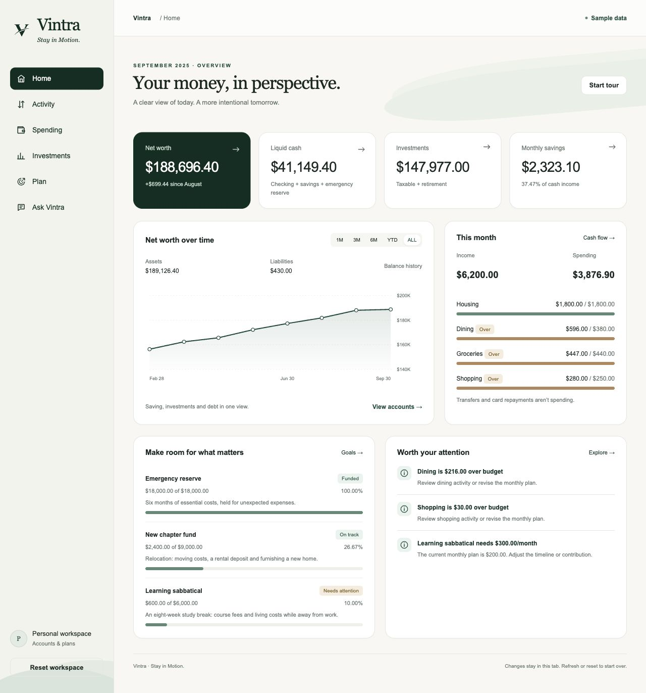
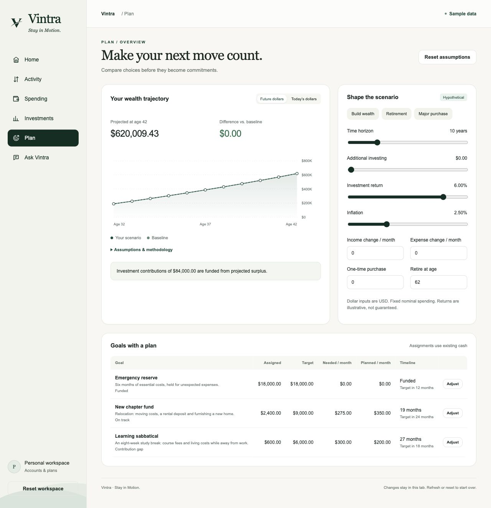
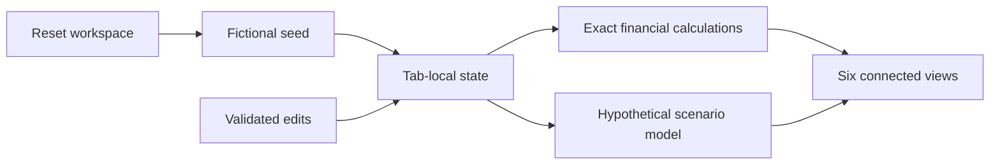

<p></p>

# Vintra

**Stay in Motion.**

An interactive personal-finance sandbox that connects a balance sheet, transaction ledger, budgets, investments and future financial decisions in one clear interface.

**Pre-populated, independently created sample financial records.** Visitors can change the sample data, see calculations update, and reset the experience. No sign-in, bank connection, API or runtime AI is involved.

## [Explore the Live Demo →](https://vincent-ton.github.io/vintra/)

No sign-in. Open the dashboard, change a transaction, adjust a goal or compare a financial scenario.



## Explore in three minutes

1. **Home:** inspect the balance sheet and the net-worth trend.
2. **Activity:** edit a purchase or add a new one. Watch spending, card debt and savings update.
3. **Spending:** compare actuals with budgets, inspect category variances and review recurring commitments.
4. **Investments:** sort holdings, combine accounts and inspect allocation and cost basis.
5. **Plan:** change investing, income, expenses, inflation or a major purchase. Compare projected wealth with the baseline.
6. **Ask Vintra:** choose a financial question and get an evidence-backed, deterministic answer.

**Reset workspace** restores all original records and assumptions. Changes stay in memory in the current tab; refreshing starts a new session. There is no cloud synchronization or persistent browser storage.

## Financial capabilities

- Exact-cent assets, liabilities, net worth, cash flow and savings rates.
- A coherent eight-month fictional ledger with purchases, refunds, salary, paired transfers, card repayments, investment contributions and dividends.
- Category budgets with dollar/percentage variance, merchant rankings, recurring commitments and monthly comparisons.
- Real ETF and stock identities with sample holdings and reference prices, fractional shares, remaining cost basis, unrealized gains, account allocation and cash-aware portfolio weights.
- Monthly wealth modeling with editable horizons, income/spending changes, blended investment returns, inflation-adjusted values, salary-stop retirement and one-time purchases.
- Goal funding gaps, required monthly savings, illustrative completion timelines and protection against double-assigned cash.
- Twelve guided financial questions using the same calculations as the rest of the application.
- Accessible chart points with exact-value tooltips, optional tour, responsive navigation and scrollable detailed tables.



More screenshots: [Activity](docs/screenshots/activity-desktop.png), [Spending](docs/screenshots/spending-desktop.png), [Investments](docs/screenshots/investments-desktop.png), [Ask Vintra](docs/screenshots/ask-desktop.png), [mobile Home](docs/screenshots/home-mobile.png).

## Architecture



Browser-native JavaScript modules, HTML, CSS and SVG. **Zero package dependencies**, no backend and no runtime network services. The static site uses relative assets and hash routes, so it works under the `/vintra/` project path without server rewrites. GitHub Actions tests and builds the static application, then deploys only `dist/` to GitHub Pages.

Only explicitly reviewed, self-contained brand geometry and fixed-point arithmetic were reused from the existing product. Server-bound modules, authentication, imports, databases, uploaded documents and private records were not copied. The demo’s dataset and state adapters were created independently.

## Run locally

Requirements: Python 3 for the optional preview; Node.js 22+ for builds and tests. No package installation is required.

```sh
node scripts/build.mjs
python3 scripts/serve.py
```

Open `http://127.0.0.1:5187/vintra/`. The preview binds to the local machine only.

```sh
node --test tests/*.test.mjs
```

The build copies reviewed static source/assets to `dist/`. There are no environment variables, API keys or server/database credentials.

## Calculation conventions

Money uses integer USD cents with BigInt intermediates for scaled arithmetic. Share quantities retain fixed precision; displayed currency is rounded to two decimals. Refunds reduce spending; paired transfers, card repayments and investment contributions do not become income or consumption.

Portfolio value includes investment cash. Unrealized gains exclude cash and compare holdings with adjusted basis. The account-value history includes contributions and dividends; it is **not** a time-weighted or money-weighted return series.

Projections apply nominal annual investment rates divided by 12, with contributions before monthly growth. Income and expenses are fixed nominal assumptions; cash earns zero, debt is held constant, and credit receivables remain restricted. Retirement stops modeled salary and draws down available assets. Major purchases consume cash; they do not create home equity. Additional investing reallocates existing surplus, rather than inventing income. Taxes, benefits, stochastic simulations and future market guarantees are outside this demonstration.

## Privacy and security

No personal records were imported, anonymized or transformed into this seed. Account records, amounts, positions, costs, prices and histories are independently invented. Institution, merchant and security names refer to real entities; they do not imply affiliation or actual market observations. The application has no access to any private financial environment.

No analytics, external fonts, remote assets, network clients, account linking, document uploads, cookies, service workers or persistent browser storage are implemented. A restrictive Content Security Policy blocks network connections, workers, plugins and form transmission. Visitor text is escaped, and financial edits are validated before mutation.

See the [public release verification](docs/RELEASE_VERIFICATION.md), [privacy verification](docs/PRIVACY_VERIFICATION.md), [functional test report](docs/VERIFICATION.md), and [deployment setup](docs/DEPLOYMENT_REVIEW.md).

## Development approach and limits

Developed iteratively with AI-assisted implementation and review. Financial logic is checked against known expected values and independent arithmetic; browser tests verify actual interactions. This describes the development process, not runtime generative AI. The application provides a fictional educational demonstration, not financial advice or production banking software.

Phone-sized browser layouts were tested; physical iPhone/Safari installation and exhaustive assistive-technology compatibility are not certified. Native BigInt, ES modules and modern browser dialog support are required.

Project ownership is represented by the public GitHub repository and account `vincent-ton`. There is no creator profile or personal attribution inside the application. Source is provided for inspection; no open-source license is granted by this repository.

### Recognizable names, independent sample records

Holdings use ITOT, IXUS, AGG, USRT and Visa. Merchants include familiar grocery, dining, transport and subscription providers. All account ownership, quantities, prices, costs, transactions, dividends and history are illustrative sample values, not actual user records or verified market observations. Names imply no affiliation. The product keeps one discreet disclosure; forecasts retain their important assumptions and limitations.
